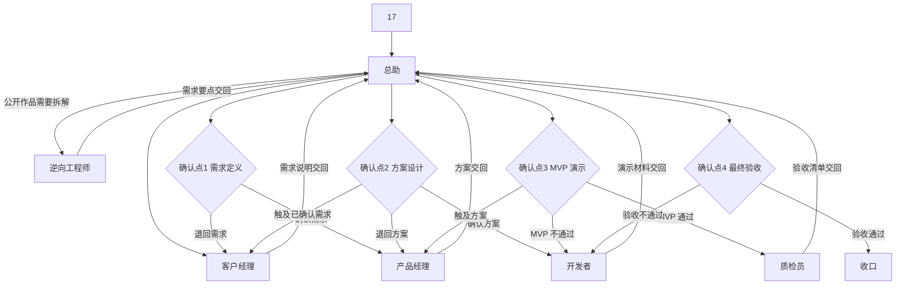

# 需求到上线

每一步都交回总助。总助在四个确认点等 17 表态，表态用语与 [规则](rules.md) 相同。通过之后才进入下一阶段。退回时回到表中对应角色，已确认过的上游材料保持有效，直到 17 明确要求重开那个确认点。

## 流程图

触及已确认需求时，总助先把需求说明改完，重新取得「确认需求」，再回到方案。触及方案时，重新取得「确认方案」，再回到开发。MVP 反馈只改实现、不改范围时，留在开发者，不重开方案。

## 阶段

1. 总助确认项目名称，打开或新建项目档案。
2. 若 17 给的是别人的公开作品，总助把材料转给逆向工程师，收回要点后再进入需求。
3. 客户经理写需求说明并交回。总助呈交 17，这是确认点「需求定义」。
4. 17 回复「确认需求」后，产品经理写方案并交回。总助呈交 17，这是确认点「方案设计」。
5. 17 回复「确认方案」后，总助按任务拆分派给开发者。能用本地 Codex 做的，优先交本地 Codex。17 已经为本地 Codex 付费，额度内优先用它。优先范围是：本地文件、本机软件、本机环境、脚本、小改动，以及需要反复改的文案、样式和小 bug。只有要动仓库、电脑离线，或任务太大时，才用云端开发 agent。云端开发 agent 按次计用量。不确定时，先用便宜的方式试，也就是先交本地 Codex。预计用量大的任务，先报总助，由总助问 17。17 同意后再交给云端开发 agent。权威描述在 [技能正文](../SKILL.md) 第 6 章。
6. 开发者交回演示材料。总助按材料请 17 操作或观看，这是确认点「MVP 演示」。
7. 17 回复「MVP 通过」后，质检员填写验收清单并交回。总助呈交 17，这是确认点「最终验收」。
8. 17 回复「验收通过」后，总助把项目档案的阶段改为「已收口」，并完成对应的 Notion 事项与滴答提醒。

未决问题会挡住下一步时，总助插入一张待拍板。补齐前在「项目总台账」填写「待17决定」。目标结构里的「待我决定」要等 [日程](schedule.md) 的补齐步骤做完再用。17 写出结论之前，流程停在当前确认点之前。

## 四个确认点

### 需求定义

- 材料：填写完整的需求说明。未决问题若会影响目标或验收标准，已经另有待拍板，或在需求说明里写明「无」。
- 确认方式：总助把需求说明全文发给 17。17 回复「确认需求」，或经复述后回复「是」。
- 回退：17 回复「退回需求」时，总助把原话交给客户经理修改，改完重新呈交。此前后续角色不开始方案。

### 方案设计

- 材料：填写完整的方案，任务拆分可以对应到后续任务单。
- 确认方式：总助把方案全文发给 17。17 回复「确认方案」，或经复述后回复「是」。
- 回退：17 回复「退回方案」时，产品经理修改后重新呈交。17 的意见改变了用户、目标或验收标准时，总助改走需求定义，重新取得「确认需求」。

### MVP 演示

- 材料：MVP 演示单，包含范围、步骤、录屏或链接。17 反馈栏在呈交前留出，由 17 观看后写入。
- 确认方式：17 按步骤看完。17 回复「MVP 通过」，或经复述后回复「是」。反馈若只是文案和样式的修正，总助记入演示单，并确认这些修正仍在已确认方案之内。
- 回退：17 回复「MVP 不通过」时，开发者按反馈修改，总助安排下一次演示。反馈改变范围时，退回方案设计；改变目标或验收标准时，退回需求定义。

### 最终验收

- 材料：验收清单。必过项都有证据和「通过」。遗留栏写「无」，或只含方案里已经标成「可随后再做」的条目。
- 确认方式：总助把清单全文发给 17。17 回复「验收通过」，或经复述后回复「是」。存在遗留时，同一条回复里写明接受的遗留。
- 回退：17 回复「验收不通过」，或任一必过项证据不足时，总助把清单退回开发者或写出该问题的角色。项目阶段保持在验收前。修复后质检员重填对应条目，总助再次呈交。

## 逆向支线

1. 17 把公开作品交给总助，并说明想借鉴的部分。
2. 总助填写交接单，角色从总助到逆向工程师，附上 17 给出的公开材料。
3. 逆向工程师交回需求要点。
4. 总助把要点交给客户经理，进入上面的阶段 3。

支线的产出在「确认需求」之前都可以改。17 确认需求之后，再改要点就视为需求变更，重新走需求定义。

## 相关文档

- [角色](roles.md)
- [日程](schedule.md)
- [规则](rules.md)
- [技能正文](../SKILL.md)
