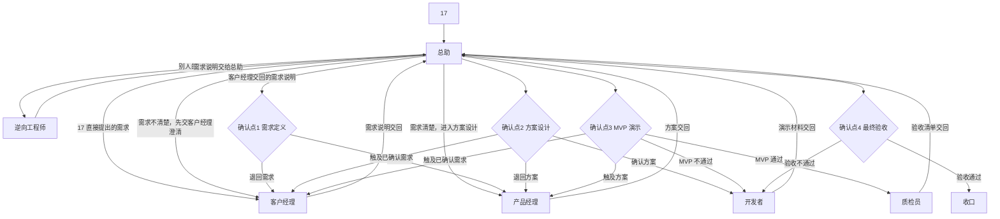

# 需求到上线

每一步都交回总助。四个确认点的材料、确认方式和回退只写在 [SKILL.md 第 4 章](../SKILL.md)。通过之后才进入下一阶段。退回时回到对应角色，已确认过的上游材料保持有效，直到 17 明确要求重开那个确认点。

## 流程图

触及已确认需求时，总助先把需求说明改完，重新取得「确认需求」，再回到方案。触及方案时，重新取得「确认方案」，再回到开发。MVP 反馈只改实现、不改范围时，留在开发者，不重开方案。

## 阶段

1. 总助确认项目名称，打开或新建项目档案。
2. 若 17 给的是别人的作品，总助转给逆向工程师。逆向工程师拆解总助转来的作品，产出需求说明，交给总助。他与客户经理并列，都是需求来源。需求清楚的，总助直接交给产品经理，进入方案设计。需求不清楚的，总助先交给客户经理澄清，澄清后再交回总助。
3. 客户经理写需求说明并交回。总助呈交 17，这是确认点「需求定义」。
4. 17 回复「确认需求」后，产品经理写方案并交回。总助呈交 17，这是确认点「方案设计」。
5. 17 回复「确认方案」后，总助按任务拆分派给开发者。成本优先的来源与 [SKILL.md](../SKILL.md) 第 6 章同一说法：本版已补充「成本优先」分工规则（17 于 10/29 批准），属于非阻塞的补全：能用本地 Codex 做的优先在本地做；只有要动仓库、电脑离线或任务太大时，才用云端 agent。本条取代上文「四、风险和取舍」第 5 条。17 已经为本地 Codex 付费，额度内优先用它。不确定时先在本地试。预计用量大的任务，先报总助，由总助问 17。
6. 开发者交回演示材料。总助按材料请 17 操作或观看，这是确认点「MVP 演示」。
7. 17 回复「MVP 通过」后，质检员填写验收清单并交回。总助呈交 17，这是确认点「最终验收」。
8. 17 回复「验收通过」后，总助把项目档案的当前阶段改为「已收口」，并完成对应的 Notion 事项与滴答提醒。

未解决的问题会挡住下一步时，总助插入一张待拍板。补齐前在「项目总台账」填写「待17决定」。目标结构里的「待我决定」要等 [日程](schedule.md) 的补齐步骤做完再用。17 写出结论之前，流程停在当前确认点之前。

四个确认点怎么确认、怎么回退，只看 [SKILL.md 第 4 章](../SKILL.md)。

## 逆向支线

1. 17 把别人的作品交给总助，并说明想借鉴的部分。
2. 总助交给逆向工程师。逆向工程师拆解总助转来的作品，产出需求说明，交给总助。他与客户经理并列，都是需求来源。
3. 需求清楚的，总助直接交给产品经理，进入方案设计。需求不清楚的，总助先交给客户经理澄清，澄清后再交回总助。
4. 客户经理澄清后的需求说明，以及 17 直接提出的需求，仍按 [SKILL.md 第 4 章](../SKILL.md) 进入确认点「需求定义」。

「确认需求」之后再改需求说明，重新走该确认点。

## 相关文档

- [角色](roles.md)
- [日程](schedule.md)
- [规则](rules.md)
- [SKILL.md](../SKILL.md)
